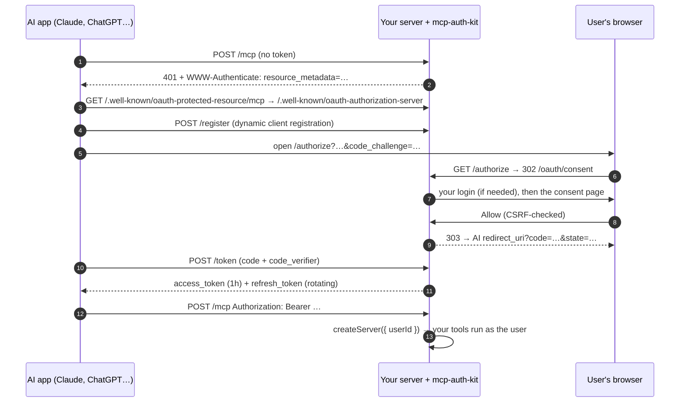

# mcp-auth-kit

**Drop-in OAuth 2.1 for remote MCP servers in Node.js / TypeScript.**

[](https://github.com/umesh-saini/mcp-auth-kit/actions/workflows/ci.yml)
[](https://www.npmjs.com/package/mcp-auth-kit)
[](LICENSE)

Your users click **"Connect"** in Claude, ChatGPT, Cursor or VS Code, sign in to **your** app, approve access, and the AI can call your tools as that user. `mcp-auth-kit` gives you everything that has to happen in between, in one function call:

```ts
const auth = createMcpAuth({ issuerUrl: 'https://api.example.com', store, secret, getUser: (req) => req.user });

auth.mount(app, {
  createServer: ({ userId }) => buildMyMcpServer(userId), // your tools, already scoped to the signed-in user
});
```

Getting this right by hand means reading the MCP authorization spec plus six RFCs and testing a lot of redirects. This kit was extracted from a production app ([SangeetFlow](#where-it-comes-from), where Claude and ChatGPT create and publish YouTube videos through MCP). It ships with an end-to-end test suite that covers each of those RFCs.

---

## What you get

| | |
|---|---|
| ✅ **OAuth 2.1 authorization server** | Authorization code + **PKCE (S256)** only, as the MCP spec requires |
| ✅ **Dynamic Client Registration** (RFC 7591) | Claude, ChatGPT & co. register themselves; no client IDs to hand out |
| ✅ **Discovery metadata** | RFC 8414 authorization-server metadata + RFC 9728 protected-resource metadata, and `WWW-Authenticate` on 401s |
| ✅ **Built-in consent page** | Shows the app, the signed-in user and the redirect host. CSRF-protected, clickjacking-proof, dark mode. Swap it for your own UI anytime |
| ✅ **Refresh-token rotation** | Every refresh issues a new pair; the old refresh token dies instantly |
| ✅ **Personal access tokens** | For clients configured with an `Authorization: Bearer …` header (CLIs, scripts, CI) |
| ✅ **Token revocation** (RFC 7009) + "connected apps" list | Let users see and disconnect AI apps from your settings page |
| ✅ **Resource indicators** (RFC 8707) | Tokens are bound to your MCP endpoint |
| ✅ **Stateless Streamable HTTP endpoint** | A fresh MCP server per request: scales horizontally, no sticky sessions |
| ✅ **Bring your own database** | A 10-method store interface. Ships `MemoryStore`, plus copy-paste [MongoDB, Postgres and Redis](docs/storage.md) stores |
| ✅ **Secure by default** | Only SHA-256 hashes of tokens are stored, client secrets are encrypted at rest (AES-256-GCM), codes are single-use and last 5 minutes |
| ✅ **Typed** | Written in TypeScript, ESM, Express 4 and 5 |

## Where you can use it

- **SaaS products adding "Use with Claude / ChatGPT".** Let customers drive your product (CRM, project tracker, analytics, invoicing, e-commerce admin) from their AI assistant, acting as themselves with their own permissions.
- **Content & social-media automation.** Let an AI assistant draft, schedule and publish **YouTube videos, Shorts and Instagram Reels** for a signed-in creator. This is what the kit does in production.
- **Internal tools and company data.** Give employees an MCP connector to internal APIs, dashboards or databases behind your existing SSO login.
- **Developer platforms.** Hosting, CI, monitoring, feature flags: give coding agents (Claude Code, Cursor, VS Code Copilot) authenticated access with per-user tokens, plus personal tokens for scripts.
- **Multi-tenant AI agents.** Any agent backend that must know *which user* is calling a tool, not just that someone has an API key.
- **Learning OAuth.** It's a small, readable implementation of OAuth 2.1 + PKCE + DCR with tests for every rule.

## Install

```bash
npm install mcp-auth-kit @modelcontextprotocol/sdk express
```

Node.js 20+.

## Quick start

```ts
import express from 'express';
import { z } from 'zod';
import { McpServer } from '@modelcontextprotocol/sdk/server/mcp.js';
import { createMcpAuth, MemoryStore, ok } from 'mcp-auth-kit';

const app = express();
// ... your existing session / login middleware ...

const auth = createMcpAuth({
  issuerUrl: 'https://api.example.com',  // your public origin (http://localhost is fine in development)
  store: new MemoryStore(),              // use a database store in production → docs/storage.md
  secret: process.env.AUTH_SECRET!,      // 32+ random chars: openssl rand -base64 48
  serviceName: 'Acme',
  scopes: ['acme'],
  getUser: (req) => (req.session?.user ? { id: req.session.user.id, name: req.session.user.email } : null),
  loginUrl: '/login',                    // signed-out users go here with ?returnTo=…
});

auth.mount(app, {
  path: '/mcp',
  createServer: ({ userId }) => {
    const server = new McpServer({ name: 'acme', version: '1.0.0' });
    server.registerTool(
      'list_projects',
      { description: "The user's projects", inputSchema: { limit: z.number().max(50).default(10) } },
      async ({ limit }) => ok(await db.projects.find({ ownerId: userId }).limit(limit))
    );
    return server;
  },
});

app.listen(3000);
```

That's the whole integration. Your MCP URL is `https://api.example.com/mcp`.

**Try the bundled example** (a per-user notes app with a demo login):

```bash
git clone https://github.com/umesh-saini/mcp-auth-kit && cd mcp-auth-kit && npm install
npm run example
npx @modelcontextprotocol/inspector   # Transport: Streamable HTTP · URL: http://localhost:3000/mcp
```

## How it works



Routes added to your app (all at the site root, as the spec expects):

| Route | Purpose |
|---|---|
| `GET /.well-known/oauth-authorization-server` | RFC 8414 metadata |
| `GET /.well-known/oauth-protected-resource/mcp` | RFC 9728 metadata |
| `POST /register` | Dynamic client registration |
| `GET /authorize` | Starts the flow, redirects to the consent page |
| `GET, POST /oauth/consent` | Built-in consent page (omitted when you set `consentUrl`) |
| `POST /token` | Code exchange and refresh |
| `POST /revoke` | Token revocation |
| `POST /mcp` | Your MCP server (Streamable HTTP, stateless, bearer-protected) |

## Connecting AI clients

| Client | How |
|---|---|
| **Claude** (claude.ai, Desktop, mobile) | Settings → Connectors → *Add custom connector* → paste `https://your-host/mcp` |
| **Claude Code** | `claude mcp add --transport http acme https://your-host/mcp` and then `/mcp` to sign in |
| **ChatGPT** | Settings → Connectors (developer mode) → *Create* → MCP server URL, auth: OAuth |
| **Cursor** | `~/.cursor/mcp.json` → `{ "mcpServers": { "acme": { "url": "https://your-host/mcp" } } }` |
| **VS Code** | `.vscode/mcp.json` → `{ "servers": { "acme": { "type": "http", "url": "https://your-host/mcp" } } }` |
| **MCP Inspector** | `npx @modelcontextprotocol/inspector` → Streamable HTTP → your URL |
| **Scripts / CI** | A personal token: `Authorization: Bearer <prefix>_pat_…` |

More detail, including troubleshooting: [docs/clients.md](docs/clients.md).

## API

### `createMcpAuth(options)`

| Option | Type | Default | |
|---|---|---|---|
| `issuerUrl` | `string \| URL` | **required** | Public origin. `https://` in production. |
| `store` | `OAuthStore` | **required** | Persistence ([docs/storage.md](docs/storage.md)). |
| `secret` | `string` | **required** | ≥ 32 chars. Signs consent CSRF tokens, encrypts client secrets. |
| `getUser` | `(req) => {id, name?} \| null` | | Your signed-in user. Required for the built-in consent page. |
| `loginUrl` | `string` | | Where signed-out users go (`?returnTo=` is appended). |
| `consentUrl` | `string` | built-in | Use your own consent UI (see below). |
| `scopes` | `string[]` | `['mcp']` | Scopes your server supports. |
| `serviceName` | `string` | `'MCP server'` | Shown on the consent page and in metadata. |
| `tokenPrefix` | `string` | `'mcp'` | Tokens look like `acme_at_…`, `acme_rt_…`, `acme_pat_…`, so secret scanners can spot them. |
| `accessTokenTtl` | `number` (s) | `3600` | |
| `refreshTokenTtl` | `number` (s) | 60 days | |
| `isUserActive` | `(userId) => boolean` | | Return `false` to lock out suspended users' existing tokens. |
| `renderConsentPage` | `(data) => string` | | Restyle the built-in consent page. |

It returns:

```ts
auth.mount(app, { path?, createServer, requiredScopes?, middleware?, bodyLimit?, onError? }) // → { mcpUrl }
auth.router(resourceUrl?)            // OAuth routes only, if you wire /mcp yourself
auth.protect(resourceUrl, scopes?)   // bearer middleware for any other route
auth.provider                        // the raw OAuthServerProvider for the MCP SDK

// Consent (for a custom consent UI)
auth.getConsentRequest(requestId)    // → { clientName, clientUri, redirectHost, scopes } | null
auth.approveConsent(requestId, userId) // → redirect URL
auth.denyConsent(requestId)          // → redirect URL

// Settings page
auth.listTokens(userId)              // connected apps + personal tokens (no secrets)
auth.revokeTokenById(userId, id)     // disconnect / delete
auth.createPersonalToken(userId, name) // → { token, record }; show the token once
```

`createServer(ctx)` receives `{ userId, tokenId, kind: 'oauth' | 'pat', clientId, scopes, authInfo, req }`.

### Tool helpers

```ts
import { ok, fail, withAuth } from 'mcp-auth-kit';

server.registerTool('delete_project', { inputSchema: { id: z.string() } },
  withAuth(async ({ id }, { userId, scopes }) => {
    if (!scopes.includes('acme:write')) return fail('This connection is read-only.');
    await projects.delete({ id, ownerId: userId });   // throwing also becomes a readable tool error
    return ok({ deleted: id });
  }));
```

### Rate limiting

The OAuth endpoints are rate-limited by the MCP SDK. For `/mcp`, pass any Express middleware:

```ts
import rateLimit from 'express-rate-limit';
auth.mount(app, { createServer, middleware: [rateLimit({ windowMs: 60_000, limit: 120 })] });
```

### Your own consent UI

Already have a React/Vue app? Set `consentUrl: 'https://app.example.com/connect'`. The kit redirects there with `?request=<id>`. Your page calls your API, and your API calls the kit:

```ts
app.get('/api/connect/:id', requireLogin, async (req, res) => res.json(await auth.getConsentRequest(req.params.id)));
app.post('/api/connect/:id', requireLogin, async (req, res) => {
  const redirect = req.body.approve ? await auth.approveConsent(req.params.id, req.user.id) : await auth.denyConsent(req.params.id);
  res.json({ redirect }); // the SPA does window.location = redirect
});
```

Protect those API routes against CSRF the way you protect the rest of your app (SameSite cookies + JSON bodies, or CSRF tokens).

## Production checklist

- [ ] `issuerUrl` is your public `https://` origin, and the OAuth routes are reachable at its root.
- [ ] A database-backed store ([docs/storage.md](docs/storage.md)). `MemoryStore` forgets everything on restart.
- [ ] `secret` comes from a secret manager and is ≥ 32 random characters. Rotating it invalidates open consent forms and stored client secrets.
- [ ] `app.set('trust proxy', 1)` if you run behind a load balancer (the SDK's rate limiter needs real client IPs).
- [ ] `isUserActive` wired to your account status.
- [ ] A settings page that lists `auth.listTokens(user)` with a "Disconnect" button.
- [ ] Rate limiting on `/mcp`.

## Security

See [docs/security.md](docs/security.md) for the threat model (consent CSRF, clickjacking, phishing via client names, code interception, token theft) and what the kit does about each. To report a vulnerability, see [SECURITY.md](SECURITY.md).

## FAQ

**Do I need this if I use an external identity provider (Auth0, Clerk, WorkOS)?**
Not necessarily. Some providers can act as the MCP authorization server for you. `mcp-auth-kit` is for when your app *is* the identity provider: you have your own users, sessions and login, and you don't want another vendor or a second login.

**Does it support stateful sessions / SSE streams?**
The mounted endpoint is stateless (JSON responses, a new server per request). That covers tools, resources and prompts, and is the easiest to deploy. For server-initiated streams, use `auth.router()` + `auth.protect()` with your own transport.

**Can I use Fastify / Hono / Next.js?**
The routes are Express today. `auth.provider` is a standard MCP SDK `OAuthServerProvider`, so you can still use the store and token logic. Adapters are welcome as PRs.

## Where it comes from

`mcp-auth-kit` was extracted from **SangeetFlow**, a multi-user YouTube automation platform. Creators connect Claude or ChatGPT to it, and the assistant researches a topic, writes a script, renders a narrated video (using the companion library [htmlreel](https://github.com/umesh-saini/htmlreel)) and schedules it on their channel. All of that runs over this OAuth layer.

## Contributing

Issues and PRs are welcome. See [CONTRIBUTING.md](CONTRIBUTING.md). `npm test` runs the full OAuth flow against a real HTTP server in about 2 seconds.

## License

[MIT](LICENSE) © Umesh Saini
